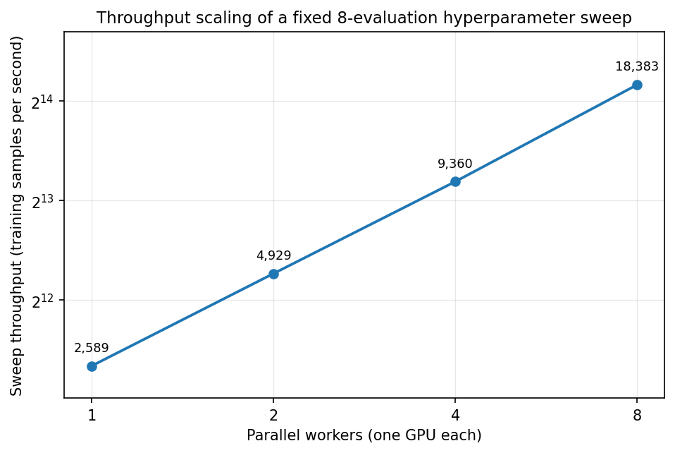

# Configuring and Running Optimizations

The [`scalefm.acquire()`][scalefm.api.acquire] function is the core interface for running Hyperparameter
and/or architecture search using optimizers in ScaleFM.
You can find most of the features ScaleFM provides through the API of this function.

This document breaks down the core arguments that allow users to control the optimization process in ScaleFM.

---

## Required Arguments
To operate, ScaleFM requires at minimum the following three arguments
[`scalefm.acquire(evaluate_pipeline=..., pipeline_space=..., total_cost_to_spend=...)`][scalefm.api.acquire],
or, for [asynchronous evaluation](evaluate_pipeline.md#3-asynchronous-evaluation-advanced),
`scalefm.acquire(is_async=True, pipeline_space=..., total_cost_to_spend=...)`:

```python
import scalefm

def evaluate_pipeline(learning_rate: float, epochs: int) -> dict:
    # Your code here
    return {"objective_to_minimize": loss, "cost": training_flops}

class ExamplePipeline(scalefm.PipelineSpace):
    learning_rate = scalefm.Float(1e-3, 1e-1, log=True)
    epochs = scalefm.Integer(10, 100)

scalefm.acquire(
    evaluate_pipeline=evaluate_pipeline, # (1)!
    pipeline_space=ExamplePipeline(), # (2)!
    total_cost_to_spend=1e18, # (3)!
    root_directory="path/to/result_dir" # (4)!
)
```

1.  The objective function, targeted by ScaleFM for minimization, by evaluation various configurations.
    It requires these configurations as input and should return either a dictionary or a sole loss value as the output.
2.  This defines the search space for the configurations from which the optimizer samples.
    It accepts a class instance inheriting from `scalefm.PipelineSpace` or a [`configSpace.ConfigurationSpace`](https://automl.github.io/ConfigSpace/) object.
    For comprehensive information and examples, please refer to the detailed guide available [here](../reference/scalefm_spaces.md)
3.  The cost budget of the whole study, across all workers, in the unit of the `cost` that
    `evaluate_pipeline` returns, e.g. FLOPs. No new evaluation starts once it is spent.
    See [Budget, how long to run?](#budget-how-long-to-run).
4.  The directory path where the information about the optimization and its progress gets stored.
    This is also used to synchronize multiple calls to `scalefm.acquire()` for parallelization.


See the following for more:

* What kind of [pipeline space](../reference/scalefm_spaces.md) can you define?
* What goes in and what goes out of [`evaluate_pipeline()`](../reference/scalefm_acquire.md)?

## Budget, how long to run?
To define a budget, provide `total_evaluations_to_spend=` to [`scalefm.acquire()`][scalefm.api.acquire],
to specify the number of evaluations after which the whole study (across all workers) stops,
and/or `total_cost_to_spend=` to specify a cost threshold for your own custom cost metric, such as time, energy, or monetary, as returned by each evaluation of the pipeline.

Each of these also has a `worker_` variant (e.g. `worker_evaluations_to_spend=`) that limits only what a single `scalefm.acquire()` call/worker does.


```python
def evaluate_pipeline(learning_rate: float, epochs: int) -> dict:
    start = time.time()

    # Your code here
    end = time.time()
    duration = end - start
    return {"objective_to_minimize": loss, "cost": duration}

scalefm.acquire(
    total_evaluations_to_spend=10, # (1)!
    total_cost_to_spend=1000, # (2)!
)
```

1.  Specifies the total number of evaluations a worker is allowed to perform before halting the optimization process.
2.  Prevents the worker from initiating new evaluations once this cost threshold is exceeded.
    This can be any kind of cost metric you like, such as time, energy, or monetary, as long as you can calculate it.
    This requires adding a cost value to the output of the `evaluate_pipeline` function, for example, return `#!python {'objective_to_minimize': loss, 'cost': cost}`.
    For more details, please refer [here](../reference/scalefm_spaces.md)

## Scaling studies, estimating the cost of a configuration
In a scaling study the cost of a configuration, e.g. its FLOPs, is known before it is
evaluated, as it follows from the parameters marked with `is_compute_scaling=True`.
Pass it as `cost_estimator=` to [`scalefm.acquire()`][scalefm.api.acquire]:

```python
class Space(scalefm.PipelineSpace):
    width = scalefm.Integer(64, 1024, log=True, is_compute_scaling=True)
    layers = scalefm.Integer(2, 24, is_compute_scaling=True)
    learning_rate = scalefm.Float(1e-5, 1e-1, log=True)

def estimate_flops(width: int, layers: int) -> float:  # (1)!
    return ...

scalefm.acquire(
    evaluate_pipeline=evaluate_pipeline,
    pipeline_space=Space(),
    cost_estimator=estimate_flops,
    max_cost_per_config=1e12,  # (2)!
    total_cost_to_spend=1e14,  # (3)!
)
```

1.  Called with the configuration as keyword arguments. A function without `**kwargs`
    is only passed the parameters it names.
2.  Optional. Configurations estimated to cost more than this are not sampled.
3.  The estimate is used as the `cost` of every evaluation that does not report one,
    so `evaluate_pipeline` does not have to return a `cost` for this to work.

If the scaling parameters only take a finite number of values, the costs can instead
be given as a JSON file, with one record for every combination of them:

```json
[
  {"config": {"width": 256, "layers": 6},  "cost": 1.2e9},
  {"config": {"width": 256, "layers": 12}, "cost": 2.4e9},
  {"config": {"width": 512, "layers": 6},  "cost": 4.7e9},
  {"config": {"width": 512, "layers": 12}, "cost": 9.4e9}
]
```

```python
scalefm.acquire(..., cost_estimator="costs.json")
```

The optimizers that make use of the cost estimate are the
[scaling optimizers](optimizers.md#3-scaling-optimizers) `#!python "carbs"` and
`#!python "chinchilla"`, as well as `#!python "bayesian_optimization"`,
`#!python "random_search"` and `#!python "grid_search"`. Any other optimizer ignores it and logs a warning, the cost of
the evaluations is still filled in.

!!! note

    The cost estimator is not stored in the `root_directory`. Every worker, and every
    call continuing a run, has to pass the same one.

## Getting some feedback, logging
ScaleFM will not print anything to the console. To view the progress of workers,
you can enable logging through python's [logging.basicConfig][].

```python
import logging

logging.basicConfig(level=logging.INFO)

scalefm.acquire(...)
```

Please refer to Python's [logging documentation](https://docs.python.org/3/library/logging.html) for more information on how to customize the logging output.

### Live plots
Pass `live_plots=True` to have ScaleFM redraw the plots in `root_directory/summary/` after
every evaluated trial: the scaling plots, plus anything your optimizer provides.

```python
scalefm.acquire(..., live_plots=True)
```

It is off by default, since every refresh redraws the figures. You can always get the same
plots later with
`scalefm.analyze(root_directory)`. See [Analysing Runs](analyse.md#plots-and-reports-scalefmanalyze).

## Continuing Runs
To continue a run, all you need to do is provide the same `root_directory=` to [`scalefm.acquire()`][scalefm.api.acquire] as before,
and specify a new stopping criterria(e.g. through `total_evaluations_to_spend=` and/or `total_cost_to_spend=`).

```python
def run(learning_rate: float, epochs: int) -> dict:
    start = time.time()

    # Your code here
    end = time.time()
    duration = end - start
    return {"objective_to_minimize": loss, "cost": duration}

scalefm.acquire(
    # enable stoping criteria by specifying new number of evaluation desired.
    total_evaluations_to_spend=50,
)
```

If a previous run stopped because a worker exhausted its budget, and you restart the run with the same stopping criterion, each worker will again be allowed to spend up to that budget on new evaluations.

As a result, when running multiple workers or restarting a run, the total resource usage may exceed the originally intended global budget. If you have global resource constraints (for example, total cost or total number of evaluations across all workers), you are responsible for tracking and enforcing them externally.

!!! note "Auto-loading"

    When continuing a run, ScaleFM automatically loads the search space and optimizer configuration from disk. You don't need to specify `pipeline_space=` or `optimizer=` again - ScaleFM will use the saved settings from the original run.

## Reconstructing and Reproducing Runs

Sometimes you want to inspect what settings were used in a previous run, or reproduce a run with the same or modified settings. ScaleFM provides utility functions to load both the search space and optimizer information:

```python
import scalefm

# Load everything from a previous run
root_dir = "path/to/previous_run"

pipeline_space = scalefm.load_pipeline_space(root_dir)
optimizer_info = scalefm.load_optimizer_info(root_dir)

print(f"Original optimizer: {optimizer_info['name']}")
print(f"Original search space: {pipeline_space}")

# Option 1: Continue the original run (auto-loads everything)
scalefm.acquire(
    evaluate_pipeline=my_function,
    root_directory=root_dir,
    total_evaluations_to_spend=10,  # adjusted new budget
)

# Option 2: Start a new run with the same settings
scalefm.acquire(
    evaluate_pipeline=my_function,
    pipeline_space=pipeline_space,
    root_directory="path/to/new_run",
    optimizer=optimizer_info['name'],
    total_evaluations_to_spend=50,
)
```

For details on:

- [`scalefm.load_pipeline_space()`][scalefm.api.load_pipeline_space] - see [Search Space Reference](scalefm_spaces.md#loading-the-search-space-from-disk)
- [`scalefm.load_optimizer_info()`][scalefm.api.load_optimizer_info] - see [Optimizer Reference](optimizers.md#24-loading-optimizer-information)

## Overwriting a Run

To overwrite a run, simply provide the same `root_directory=` to [`scalefm.acquire()`][scalefm.api.acquire] as before, with the `overwrite_root_directory=True` argument.

```python
scalefm.acquire(
    ...,
    root_directory="path/to/previous_result_dir",
    overwrite_root_directory=True,
)
```

!!! warning

    This will delete the folder specified by `root_directory=` and all its contents.

## Getting the results
The results of the optimization process are stored in the `root_directory=`
provided to [`scalefm.acquire()`][scalefm.api.acquire].

=== "Result Directory"

    The root directory after utilizing this argument will look like the following:

    ```
    root_directory
    ├── configs
    │   ├── config_1
    │   │   ├── config.yaml     # The configuration
    │   │   ├── report.yaml     # The results of this run, if any
    │   │   └── metadata.json   # Metadata about this run, such as state and times
    │   └── ...
    ├── summary
    │   ├── full.csv
    │   └── ...                 # Plots, with live_plots=True or scalefm.analyze()
    ├── optimizer_info.yaml     # The optimizer's configuration
    ├── optimizer_state.pkl     # The optimizer's state, shared between workers
    └── ...                     # Other scalefm files
    ```

To check on a run use `scalefm.status`, and to (re)generate its plots and reports at any time
use `scalefm.analyze(root_directory)`. You can also log to TensorBoard from inside your
training loop. For more information, please refer to the [analyses page](analyse.md).

## Parallelization

ScaleFM utilizes the file-system and locks as a means of communication for implementing parallelization and resuming runs.
As a result, you can start multiple [`scalefm.acquire()`][scalefm.api.acquire] from different processes however you like
and they will synchronize, **as long as they share the same `root_directory=`**.
Any new workers that come online will automatically pick up work and work together to until the budget is exhausted.

!!! tip "Interactive tutorial"

    The [ScaleFM demo](https://colab.research.google.com/github/automl/scalefm/blob/master/tutorials/scalefm_demo.ipynb) runs several workers in parallel on one `root_directory`, sharing a single FLOP budget.

=== "Worker script"

    ```python
    # worker.py
    scalefm.acquire(
        evaluate_pipeline=...,
        pipeline_space=...,
        root_directory="some/path",
        worker_evaluations_to_spend=100, # (1)!
        continue_until_max_evaluation_completed=True, # (2)!
        overwrite_root_directory=False, #!!!
    )
    ```

    1.  Limits the number of evaluations for this specific call of [`scalefm.acquire()`][scalefm.api.acquire].
    2.  Evaluations in-progress count towards worker_evaluations_to_spend, halting new ones when this limit is reached.
        Setting this to `True` enables continuous sampling of new evaluations until the total of completed ones meets worker_evaluations_to_spend, optimizing resource use in time-sensitive scenarios.

    !!! warning

        Ensure `overwrite_root_directory=False` to prevent newly spawned workers from deleting the shared directory!


=== "Shell"

    ```bash
    # Start 3 workers
    python worker.py &
    python worker.py &
    python worker.py &
    ```

Adding workers scales the throughput of a sweep almost linearly: in our VLM example,
8 workers (one GPU each) run the same 8-evaluation sweep about 7× faster than one.



## Handling Errors

Things go wrong during optimization runs and it's important to consider what to do in these cases.
By default, ScaleFM will halt the optimization process when an error but you can choose to `ignore_errors=`.

```python
def run(learning_rate: float, epochs: int) -> dict:
    if whoops_my_gpu_died():
        raise RuntimeError("Oh no! GPU died!")

    ...
    return {"objective_to_minimize": loss, "cost": training_flops}

scalefm.acquire(
    ignore_errors=True, # (1)!
)
```

1. Continue the optimization process even if an error occurs, otherwise throwing an exception and halting the process.

!!! note

    Any runs that error will still count towards `total_evaluations_to_spend`.

### Re-running Failed Configurations

Sometimes things go wrong but not due to the configuration itself. If you want to reset failed or crashed trials so they get re-evaluated, use the `scalefm clean` command:

```bash
python -m scalefm.clean --root-dir <root_directory>
```

This resets all failed, crashed, and corrupted trials in your working directory back to `pending`, keeping their configs. To reset specific trials by ID:

```bash
python -m scalefm.clean --root-dir results/my_optimization --trial-ids 1 2
```

You can preview what would change with `--dry-run`:

```bash
python -m scalefm.clean --root-dir <root_directory> --dry-run
```

If you'd rather remove the trials entirely instead of resetting them, pass `--delete`.

Once cleaned, you can restart the optimization and workers will pick up from the cleaned state.

For more details on the clean command, see the [Cleaning Up Trials documentation](./clean.md).

## Selecting an Optimizer
By default [`scalefm.acquire()`][scalefm.api.acquire] uses `random_search`. With `optimizer="auto"`, ScaleFM selects the optimizer based on your `pipeline_space=`: `bayesian_optimization` for a space without priors and fidelities, and `random_search` otherwise, see [automatic optimizer selection](optimizers.md#21-automatic-optimizer-selection).

You can also manually select a specific or custom optimizer that better matches your specific needs.
For more information about the available optimizers and how to customize your own, refer [here](../reference/optimizers.md).
